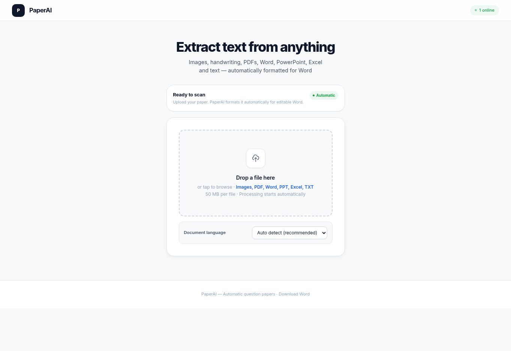
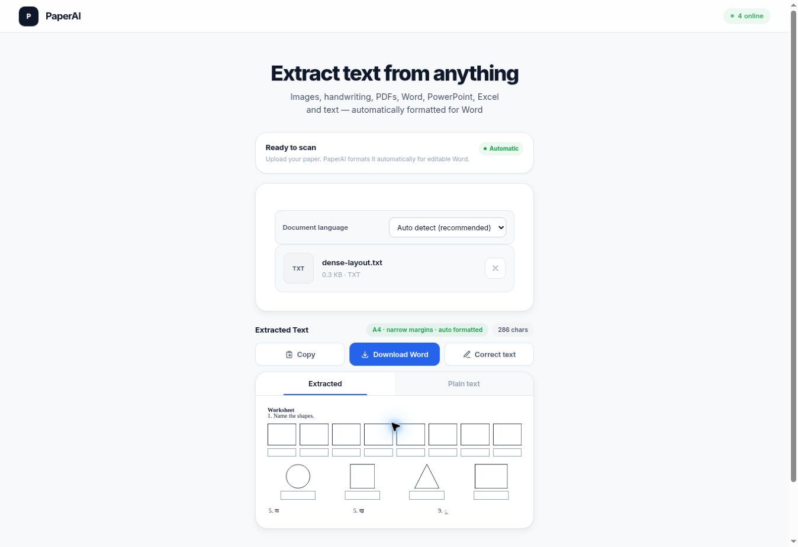

# PaperAI timeout and resume verification

For the later parallel-processing release, current Gemini check and 21-page timing, see [Parallel PDF verification](PARALLEL_PDF_VERIFICATION.md). This record describes the earlier release.

The deployed fix addresses the interrupted scan reported as “Could not reach PaperAI OCR” after one of two pages. Production code is `972a9ae0cb74af42ae734ba91a19eabcca502ee4`, deployed on 2026-10-13 at [PaperAI](https://paperai-5up.pages.dev/). This record was finalized on 2026-10-14.

## What changed

- An accepted image upload returns a job acknowledgement. The browser polls for the result using the same random request ID, so a dropped connection can recover without submitting the accepted page again.
- The service keeps completed results for ten minutes. Retry/resume collects that result; completed document pages remain available while the same file stays open in the current tab.
- A primary scan that exceeds the initial ten-second wait remains active while the backup starts. The first usable result wins. Backup failure no longer discards an already accepted primary scan. One brief retry handles an explicit temporary capacity rejection.
- The first Gemini pass uses one full-resolution image. Enlarged detail views are reserved for repair or independent verification, reducing repeated image work.
- Provider work has a 70-second page budget; optional verification has an 18-second budget. Browser requests are short, bounded and resumable. These limits bound individual stages, not the duration of every complete document.
- Native Word shapes and answer boxes fit their columns. Header/grid normalization and editor-to-Word text preservation received regression coverage.

## Evidence

| Check | Result |
| --- | --- |
| Local regression suites | All 20 passed |
| Frontend deployment | [Passed](https://github.com/Jackyhelloboy/paperai/actions/runs/38424184987) |
| Reader deployment and image check | [Passed](https://github.com/Jackyhelloboy/paperai/actions/runs/38424185009) |
| Worksheet verification | [Passed](https://github.com/Jackyhelloboy/paperai/actions/runs/38424185165) |
| Bounded production check | 180 requests, zero failures, up to 20 concurrent; public routes and synthetic text |
| Synthetic image | Completed in 6.926 seconds; job acknowledged in 527 ms |
| Real `training/class 2 hindi.pdf` | Both pages completed; cancelled during page 2, resumed the same file, retained page 1 |
| Actual Word download | Two A4 pages; 205/205 editor word/number tokens preserved; no internal layout markers |
| Dense Word fixture | 12 editable shapes on one page, within column widths; earlier live check |
| Existing reference corpus | 84 files audited: 42 original inputs/references and 42 generated QA baselines |

The real PDF tab was kept open through the backend update. Its frontend revision was `57a47041af5e3f0ac1a5cf8b8fdc9b3751a7bf79`; frontend source is unchanged between that revision and the deployed revision. Deliberate cancellation, manual resume and inspection mean the PDF run is not an uninterrupted speed benchmark.

## Remaining limitations

Gemini's key and configured model endpoints validated, but the independent generation check timed out during the latest deployment. Valid credentials alone do not establish service availability. The primary reader remained usable and completed the PDF test.

The Word render remains imperfect: some Hindi glyphs and question numbers differ from the source; an alphabet response remains instead of blank cells; pipe characters remain in several rows; header underscores wrap; and one barakhadi label is on the page before its grid. Review recognized text and page breaks before printing. Token preservation measures editor-to-Word fidelity, not source OCR accuracy or punctuation/spacing identity.

The result cache lasts ten minutes. Completed pages are retained in the current open file, not across a refresh or closed tab. If that file is still open, use **Retry / resume processing**. Do not upload its completed pages again.

No hosted model weights were fine-tuned. The changes use reader instructions, measured references and deterministic layout. Fonts are declared rather than embedded, so native rendering also depends on the opening application.

## Captures

The current deployed dashboard, captured on 2026-10-14 after the prior scan tab was cleaned up between sessions:

Earlier completed dense-layout fixture at revision `44b084d2ff73a2f43eefdcb860a22d03eebbbfb6` (this is not the two-page PDF result):

Machine-readable measurements, file hashes and exact check scope are in [WORD_EXPORT_PRODUCTION_CHECK.json](WORD_EXPORT_PRODUCTION_CHECK.json).
