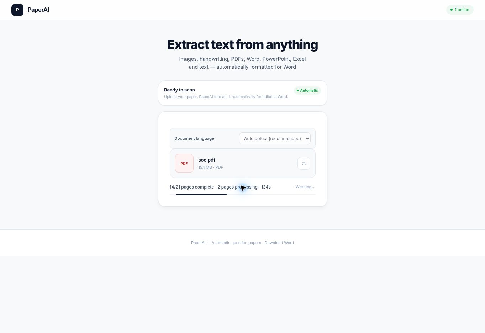

# Parallel PDF verification

PaperAI processes scanned PDFs with two concurrent page workers. The 21-page live scan on 2026-10-14 completed within **230 seconds** without a manual retry or cancellation; its actual Word download succeeded. This is the observed upper bound, not an exact completion timestamp or a measured speedup against the former serial implementation.

The tested core release is `f9ef9feab861b38fed72152876f03c0a11c2c966` at [PaperAI](https://paperai-5up.pages.dev/).

## Processing and recovery

Pages are rendered only when a worker slot is available, so long PDFs do not keep all rendered bitmaps in memory. The two workers use the same scale 2.5 and JPEG quality 0.94 as before. Native text and editable PDF paths still bypass OCR when usable. Each page owns its media and stable scan identity; results are assembled in source order even when requests finish out of order.

On an interruption, new launches stop and accepted peer work is allowed to finish. Completed pages remain cached while the same file stays open. Retry/resume processes the unfinished pages without uploading completed pages again. Refreshing or closing the tab is not a durable recovery guarantee.

## Verification

- All 21 regression suites passed, including bounded concurrency, lazy rendering, cancellation, resume, page/media ordering and provider fallback. An unrelated truncated local training PDF was left untouched; the committed fixture passed in an isolated corpus.
- Pages, Worker and worksheet CI passed for the core release. The public-route/synthetic-text load check completed 180 requests with zero failures at up to 20 concurrent requests. This does not measure concurrent image-model capacity.
- Gemini credentials and actual generation passed. The synthetic production image completed in 3.297 seconds, preserving its literal question without adding an answer.
- The real PDF retained all 21 source pages in order. All 15 expected question illustrations were embedded in Word. Twenty of 21 selected page phrases matched; this is a spot check, not an OCR accuracy percentage.

## Accuracy findings

The live review found omitted/added question words, one character substitution, an incorrect count of separate letter blanks, literal table markup, five unexplained trailing metadata words, and imperfect image crops. The parallel change preserves image and validation settings, but those settings do not guarantee error-free recognition.

## Follow-up release

Release `90e0d659078477750ff3645d037f19e4918b62bc` clarifies the visual distinction between question wording and completed answers, preserves separate letter-position counts, and normalizes balanced recognized table representations. Math comparisons, empty cells, valid no-colon flags, legitimate “none” options, and multiline cells remain intact. Unknown or ambiguous markup is not silently stripped.

All 12 focused regression suites passed. Running the normalizer against the saved original editor result removed all 70 recognized table tags and nonbreaking-space entities; repeat normalization was unchanged. Synthetic Word checks confirmed native rows, all empty cells and literal math text.

Five affected source pages (3, 5, 9, 10 and 17) completed within **57 seconds**, with no manual retry. Both previously omitted clue phrases remained, the extra connecting word and section-heading error were absent, and all five letter exercises had the observed three separate blank positions. The actual Word download contained 27 native tables and no literal table markup. One character substitution in a question word still remained. This targeted check is not a full accuracy score, complete visual-pagination review, or a repeat of the 21-page throughput test.

[Pages deployment](https://github.com/Jackyhelloboy/paperai/actions/runs/38516405630) and [worksheet checks](https://github.com/Jackyhelloboy/paperai/actions/runs/38516405780) passed. The [Worker deployment](https://github.com/Jackyhelloboy/paperai/actions/runs/38516405838) initially failed revision confirmation after its deploy command succeeded, before reaching the image test. Re-running the same commit passed the revision, Gemini credential, actual generation and image checks. The synthetic image completed in 3.451 seconds. The follow-up public-route check again completed 180 requests with zero failures; it is not an image-model capacity benchmark.

One OCR word substitution remains observed; answer-rule and crop details still need review. The original five trailing “none” labels were not included in the focused recheck, and unproven prose is not removed speculatively. Image resolution and verifier budgets were not lowered. Error-free OCR is not claimed.

## Captured progress

This actual production capture shows 14 of 21 pages complete, two active workers, and 134 seconds elapsed. It does not expose the document's question content.

Exact scope and measurements are in [PARALLEL_PDF_VERIFICATION.json](PARALLEL_PDF_VERIFICATION.json). Source documents and recognized content are excluded from the public repository.
